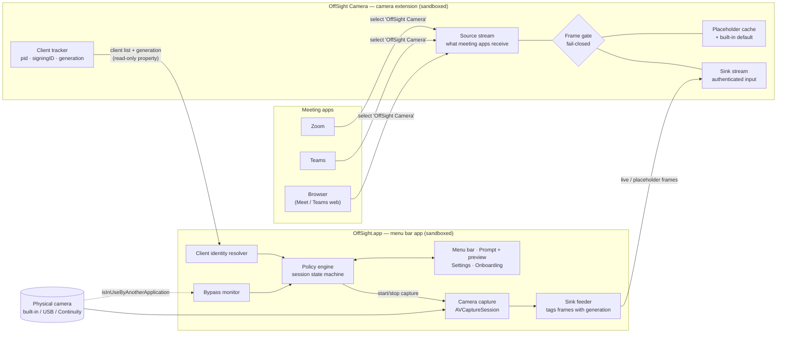
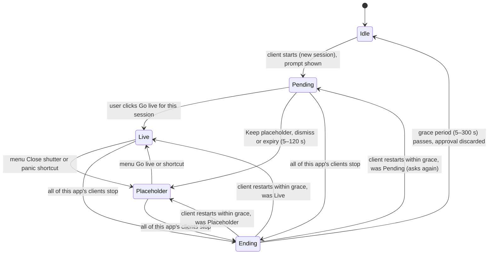

# OffSight — Architecture & Implementation Approach

| Field        | Value                                                        |
|--------------|--------------------------------------------------------------|
| Document     | Architecture & Implementation Approach (AIA)                 |
| Product      | OffSight for macOS                                           |
| Version      | 0.2 (Review decisions applied)                               |
| Status       | **Approved** (2026-10-11)                                    |
| Date         | 2026-10-11                                                   |
| Based on     | [User Requirements v0.3 (approved)](01-user-requirements.md) |

---

## 1. Purpose

This document explains **how** OffSight will meet the approved user requirements. It covers:

- the system architecture and how its parts talk to each other;
- the security model that keeps live video away from any app the user hasn't approved;
- the session and approval logic;
- macOS platform choices, build and distribution (including signing without keeping credentials in the repository);
- the testing approach, risks, and a milestone plan.

Requirement IDs (UR-xx, NFR-xx, Cx) refer to the user requirements document.

## 2. Architecture at a glance

OffSight has **two shipped components** plus a shared core library:

1. **OffSight Camera (camera extension).** A CoreMediaIO Camera Extension, a type of macOS system extension. Meeting apps see it as a camera named **"OffSight Camera"**. **By default it outputs only the placeholder**, and it passes live video through only under strict conditions that OffSight.app controls (§5).
2. **OffSight.app (menu bar app).** The "brain". It holds the approval logic, the menu bar icon, the approval prompt with its preview, settings, onboarding and bypass detection. It is the **only** process that ever opens the physical camera. It opens the camera **only** while the user is looking at a preview or an approved session is live.
3. **OffSightCore (Swift package).** Pure, platform-independent logic shared by both: the session state machine, the policy that decides live vs placeholder, settings models, client-identity tables and the protocol definitions between app and extension. It is heavily unit-tested.



### Why this shape

- **Platform limit (C1).** macOS lets no third-party utility intercept other apps' access to the built-in camera. A Camera Extension is Apple's supported way to provide a camera. It is the only virtual-camera technology that still works since macOS 14.1, and it can ship on the Mac App Store, which spike S1 will confirm.
- **The physical camera stays closed unless needed.** The extension never touches the physical camera; only the app does. So the camera's green LED is on only while you're live or previewing, which gives a hardware-backed signal that matches the menu bar icon.
- **Two independent gates.** The app decides, and the extension enforces fail-closed rules on its own. A bug or crash in either one can't produce live video for an unapproved app (§5).

## 3. Platform & technology choices

| Area | Choice | Reason / requirement |
|------|--------|----------------------|
| Minimum OS | **macOS 13.0 Ventura**; universal binary (arm64 + x86_64) | NFR-10. Intel is covered for every macOS release that still runs on Intel. |
| Language / UI | Swift 6, SwiftUI with AppKit where needed (status item, non-activating panel) | Native; good accessibility support (NFR-13). |
| Virtual camera | CoreMediaIO **Camera Extension** (`CMIOExtension`) with a source and a sink stream | C1, UR-01/02/03 |
| Capture | AVFoundation `AVCaptureSession` + `AVCaptureVideoDataOutput` | UR-29/30/31 |
| Pixel pipeline | IOSurface-backed `CVPixelBuffer`, NV12 (`420v`), `VTPixelTransferSession` for scaling | NFR-06/07/08: zero-copy, hardware scaling |
| Launch at login, crash restart | `SMAppService` (macOS 13+) | UR-38, NFR-11 |
| Extension install | `OSSystemExtensionRequest` (SystemExtensions framework) | UR-37, NFR-18 |
| Global shortcuts | Carbon `RegisterEventHotKey`, via the MIT-licensed `KeyboardShortcuts` package | UR-17/18. Works in the sandbox and needs no Accessibility permission. |
| Notifications | `UserNotifications` | UR-23 |
| Default camera | `AVCaptureDevice.userPreferredCamera` (macOS 13+) | UR-36: apps that follow the system's preferred camera pick OffSight Camera automatically. |
| Logging | `os.Logger` with privacy redaction; never logs frames | NFR-01 |
| Third-party deps | **Only** `KeyboardShortcuts` | Smaller supply-chain and review surface |

## 4. Components in detail

### 4.1 OffSight Camera (camera extension)

Packaged inside the app at `OffSight.app/Contents/Library/SystemExtensions/`. It runs as its own sandboxed process, managed by the system.

| Sub-component | Responsibility |
|---------------|----------------|
| **Device** | Shows one camera device, "OffSight Camera", with **one format, 32BGRA at 30 fps**, so meeting apps never switch resolution (UR-05, UR-28, NFR-06). The size is the live camera's native size (largest 16:9 mode, else 4:3), **scaled up, keeping its shape, to at least 1920×1440**: macOS applies each app's video effects (Portrait, Background, Studio Light…) to any camera smaller than that, and those effects blank the placeholder in Photo Booth and Teams. A 1080p camera therefore gives 2560×1440. Effects for live video are applied on OffSight's own capture instead (*Settings › Camera › Video Effects for Live Video…*), so they never touch the placeholder. A new size is applied only when no app is using the camera. |
| **Source stream** | The stream meeting apps read. It always outputs frames at a steady 30 fps, so apps never see a dead or errored camera (UR-05). |
| **Sink stream** | Receives frames from OffSight.app **only**. In `authorizedToStartStream(for:)` it checks the caller's code signature against a designated requirement: OffSight's bundle ID **and** Team ID. Any other caller is rejected (NFR-04). |
| **Client tracker** | Records every meeting-app client from `authorizedToStartStream(for:)`: `CMIOExtensionClient.pid`, `signingID`, `clientID`. It watches for process exit (dispatch process source) and stream stop. **Each change to the client set increases a `generation` counter.** It publishes `{generation, clients[]}` as a **read-only** custom device property, which the app subscribes to. |
| **Frame gate** | Decides, for each output frame, whether to send live or placeholder (§5.2). |
| **Placeholder cache** | Holds the last placeholder frame the app sent for each format. If nothing is cached (first boot, app never ran, cache lost) it uses a **built-in default placeholder compiled into the extension**, so the extension can produce a correct placeholder on its own (UR-04, UR-25). |

The extension stores **nothing on disk** and has **no network access**.

### 4.2 OffSight.app (menu bar app)

| Module | Responsibility | Requirements |
|--------|----------------|--------------|
| **ExtensionLink** | Finds OffSight Camera through the CoreMediaIO API, listens for changes to the client and generation property, and opens the sink stream. | — |
| **ClientIdentityResolver** | Turns `{pid, signingID}` into a user-facing app: name, icon and bundle ID. It tries, in order: (1) a lookup table of known meeting-app and helper signing IDs (for example, `com.google.Chrome.helper` → Chrome, the WebKit GPU process → Safari, the FaceTime conferencing daemon → FaceTime); (2) walking up the executable path to the outermost `.app` bundle; (3) a fallback of "Unknown app (signingID)", **which still requires approval**. Approval keys are the resolved **bundle ID of the host app**, so one approval covers the whole browser (UR-34). | UR-06, UR-10, UR-34 |
| **PolicyEngine** (OffSightCore) | The session state machine (§6) and the live/placeholder decision. **Approvals exist only in memory and are never saved** (UR-11). | UR-06…UR-16, UR-41 |
| **CameraCapture** | Opens the user's chosen physical camera (UR-31) **only** while a prompt preview is showing or the policy result is live. It matches the format the extension currently has active. | UR-08, UR-29…31 |
| **SinkFeeder** | Sends frames to the sink. Live frames are tagged with the generation they were approved for (§5.2). It also renders and sends the placeholder, either the custom image or initials, at every format whenever settings change. | UR-25…28 |
| **PromptController** | Shows the non-activating approval panel with a live preview, a countdown and two buttons. Several prompts stack (UR-15). Unanswered prompts expire (UR-09a). Details in §7.2. | UR-06…09a, UR-14, UR-15 |
| **StatusItemController** | Draws the menu bar icon, picking the highest-priority state: **Unprotected > Live > Paused > Protected > Idle** (§7.1). The menu lists each session with its app, state and duration, and offers go live and close shutter actions. | UR-13, UR-16, UR-20…22, UR-35a |
| **BypassMonitor** | Watches every physical camera (§8). | UR-35, UR-35a, C6 |
| **BrowserContext** | Best-effort tab or site name (§9). | UR-34a |
| **Hotkeys** | Panic (close all shutters) and go live (current prompt); both can be reassigned. | UR-17, UR-18 |
| **Onboarding** | First-run flow (§10). | UR-36, UR-37 |
| **Settings** | Five tabs, stored in `UserDefaults`. **General:** launch at login (`SMAppService`, on by default on first run), notifications when an app goes live or its session ends (default on), coloured status icon. **Camera:** live camera (automatic = built-in first, or a chosen camera), placeholder image, video effects for live video. **Approvals:** prompt expiry (5–120 s, default 30), grace period (5–300 s, default 15). **Shortcuts:** close all shutters (default ⌃⌥⌘O), go live for the app asking now (unset by default; acts only when exactly one app is asking). Global shortcuts use Carbon `RegisterEventHotKey`, which works in the sandbox without Accessibility permission. **Advanced:** install, approve or remove the camera extension; camera privacy settings; copy diagnostics. There is **no** exemption or "always allow" setting. | UR-17, UR-18, UR-23, UR-31, UR-38, UR-39, UR-40 |
| **History** (Could) | Local JSON-lines log in the app container: app, time, decision. No frames. The user can clear it. | UR-24 |
| **Lifecycle** | Handles sleep/wake, camera hot-plug, extension restart, the pause timer, and crash recovery. | UR-41, NFR-11, NFR-12 |

### 4.3 OffSightCore (Swift package)

Contains no AVFoundation or UI code, so it can be fully unit-tested:

- `SessionStateMachine`, `Policy` (live/placeholder decision), `Clock` abstraction (for testing timers)
- `ExtensionProtocol`: custom property names, the client-list encoding and the frame-tag format, shared by app and extension
- `KnownClients`: the signing-ID lookup table for meeting apps, browser helpers and conferencing daemons
- `Settings` model with valid ranges enforced (expiry 5–120 s, grace 5–300 s)

## 5. Security model: how "never live without approval" is guaranteed

### 5.1 Threats considered

| # | Threat | Mitigation |
|---|--------|------------|
| T1 | A meeting app turns its camera on by itself | It gets the placeholder. The extension's default output is the placeholder (UR-01/02/03). |
| T2 | A second, unapproved app joins while another app is live | Generation fence (§5.2): the extension switches to placeholder **at once** on any client change, before the app has even reacted. |
| T3 | A malicious local app tries to inject frames or "approve" itself through the extension | The sink accepts OffSight.app by code signature where possible; inside the extension's sandbox that check is refused (spike S5), so it accepts the client running from `/Applications/OffSight.app` (decision A7). The client list is read-only. Approvals exist only inside OffSight.app (NFR-04). **Accepted risk:** someone with admin rights who replaces `/Applications/OffSight.app` could inject frames into meetings. Nobody can *read* the camera through the sink, and any new client still drops everyone to the placeholder and must be approved. |
| T4 | Synthetic clicks or keypresses on the prompt, or automation | Approval accepts only events from the HID system event source. Clicks within 300 ms of the panel appearing are ignored. There is no AppleScript dictionary, URL scheme, Shortcuts/App Intents action or command-line flag that can approve (NFR-04, UR-14). |
| T5 | OffSight.app crashes, hangs or is quit | Live frames stop arriving, so the extension switches to placeholder within 100 ms (stale-frame watchdog). The app restarts itself (NFR-11) with all approvals empty (UR-04). |
| T6 | The extension crashes | The system restarts it. On restart its state is empty, so it outputs placeholder by default, and the generation counter restarts with a new epoch, which invalidates any earlier tags. |
| T7 | Sleep/wake, lid close, camera unplug or display changes | All sessions are ended on sleep. Unplugging the camera switches to placeholder. Nothing returns to live without a new approval (NFR-12). |
| T8 | An app uses the physical camera directly, bypassing OffSight | It is detected and the icon shows unprotected (§8). OffSight can't block it; that is a platform limit (C1). |
| T9 | Video leaving the Mac through OffSight | **Neither component has the network entitlement**, so the App Sandbox blocks all networking at the OS level. Frames live only in memory (IOSurfaces) and there is no code that writes them to disk (NFR-01/02/03). |
| T10 | The preview is captured by screen sharing | The panel uses `sharingType = .none`. Some macOS 15+ capture paths may ignore this, so it is best effort (NFR-05, spike S7). |

### 5.2 Frame gate and generation fence (inside the extension)

For every output frame (30 fps timer) **and** for every live frame that arrives:

```
emit LIVE frame only if ALL of:
  1. the frame came through the authenticated sink, and
  2. frame.tag.kind == live, and
  3. frame.tag.epoch == extension.epoch, and
     frame.tag.generation == extension.currentGeneration, and
  4. frame age < 100 ms (stale-frame watchdog)
otherwise emit the cached PLACEHOLDER for the active format
```

- **On any client-set change** (a client starts, stops or exits), the extension increases `currentGeneration` **before** publishing the new client list. Every live frame already in flight carries the old generation and is rejected. Output drops to placeholder right away.
- The app reads the new list, works out its decision again, and resumes tagging live frames with the new generation **only if every current client's app is approved** (or protection is paused).
- **Tag transport:** the tag `{kind, epoch, generation}` is attached as an IOSurface value on the frame's surface, which survives the trip between processes. Spike S5 confirms this; the fallback is a reserved metadata row in the frame, cropped before output.

**Live latency:** live frames that pass the gate are forwarded **as they arrive** (zero-copy), so OffSight adds less than one frame of latency (NFR-07). The 30 fps timer runs only to emit placeholders and to keep the frame rate steady.

### 5.3 Rule for several apps at once (design decision D-1)

The CoreMediaIO stream is **shared**: every client of OffSight Camera receives the same frames. OffSight cannot send live video to Zoom and a placeholder to Teams at the same moment. To keep UR-10 (approving one app never exposes another), the rule is:

> **Live video flows only while every app currently using OffSight Camera is approved.**

If Zoom is live and an unapproved Teams starts using the camera, **both** get the placeholder and Teams is prompted. The menu explains: "Zoom is on placeholder because Teams is also using the camera." Once Teams is approved, or stops using the camera, Zoom goes live again automatically. Its approval still holds within its session. Two meeting apps using the camera at the same time is rare, and this rule always errs on the safe side.

## 6. Sessions and approvals (PolicyEngine)

### 6.1 Per-app session state machine

The key is the **resolved host app bundle ID**, for example `us.zoom.xos` or `com.google.Chrome`.



**Rules:**

- **R1 (UR-11).** Approval is held only in the `Live` state of a session. Entering `Idle` discards it. Nothing about an approval is ever saved.
- **R2 (UR-12).** The grace period applies only while the state is `Ending`. A restart within grace returns to the earlier decision: live stays live, placeholder stays placeholder. A session that ended before the user decided (still `Pending`) has no decision to keep, so it prompts again with a fresh expiry. Photo Booth, for example, starts, stops and restarts the camera within a second as its window opens. After grace, the next start is a new session that prompts again.
- **R3 (UR-09/09a).** Dismissing or ignoring the prompt (expiry) always leads to `Placeholder` and never to `Live`.
- **R4: when a client's stop is unclear.** The extension may not report each client stopping while other clients are still streaming (spike S2). If a new start arrives for an app OffSight still thinks is active, **and** that app's last start/stop event is older than the grace period, OffSight treats it as a **new session** and prompts. It may occasionally prompt when not strictly needed, but never fails to prompt.
- **R5: sleep.** On system sleep, every session moves to `Idle`. On wake, any app still using the camera starts a new session and gets a prompt.
- **R6: pause (UR-41).** While paused, the decision is "live" for all clients and no prompts appear; the icon shows **Paused**. When the timer runs out, every active session moves to `Pending` and is prompted again.
- **R7: unknown clients.** An unidentified client is treated as its own app and must be approved. Its prompt shows the raw signing ID.

### 6.2 Live/placeholder decision

```
output_live = paused
           OR (activeClients ≠ ∅
               AND ∀ client ∈ activeClients : state(app(client)) == Live)
```

`CameraCapture` runs when `output_live` is true, or while a prompt preview is showing.

## 7. User interface

### 7.1 Menu bar icon (UR-20, UR-21, UR-35a, NFR-15)

Each state uses a distinct **shape**, not just a color. Icons are template images (SF Symbols where they fit) and each has a VoiceOver label.

| Priority | State | Icon | When |
|----------|-------|------|------|
| 1 | **Unprotected** | Camera with ⚠︎ triangle badge | Any physical camera is in use by another app (bypass). Shown alongside any other state. |
| 2 | **Live** | Solid camera with a dot, in a contrasting tint | `output_live` and not paused |
| 3 | **Paused** | Camera with ⏸ badge | Pause timer active |
| 4 | **Protected** | Camera with shield | Clients connected, placeholder showing |
| 5 | **Idle** | Outlined camera with slash | No clients |

The menu lists, for each session: app icon and name, the site name if known (UR-34a), the state, the session duration, and **Go live** or **Close shutter**. Below the sessions: **Close all shutters** (with the panic shortcut shown), Pause ▸, Settings, About. When a bypass is detected, a warning section appears at the top of the menu (§8).

### 7.2 Approval prompt (UR-06…09a, UR-14, UR-15, NFR-09, NFR-14)

- A **non-activating floating `NSPanel`** near the menu bar icon. It **does not take keyboard focus**, so a stray Return or Space in the meeting app can't approve (UR-14). It has **no default button**.
- Content: the app icon and name, plus the site if known; the question "*<App> wants to use your camera*"; a **live preview** (UR-08), which is local only and comes from the app's own capture, **never** from the sink; a countdown to expiry; and two buttons of equal weight: **Keep placeholder** and **Go live for this session**.
- Clicks during the first 300 ms are ignored, and only HID-sourced events are accepted (T4).
- Keyboard access: the optional go-live shortcut (UR-18). VoiceOver users can focus the panel with a hotkey and then Tab between the buttons (NFR-13).
- When several apps start at the same time, their prompts stack, one card per app (UR-15).
- Target time from the client starting to the panel showing: **< 500 ms** (NFR-09). The extension notifies the app through a property listener, which is event-driven rather than polled.
- The camera LED turns on while the preview is showing. Onboarding explains this.

## 8. Bypass detection (UR-35, UR-35a, C6)

- **Mechanism:** `BypassMonitor` lists every physical camera (built-in, USB/UVC, Continuity Camera) with `AVCaptureDevice.DiscoverySession`, watches for cameras being connected or disconnected, and observes each device's **`isInUseByAnotherApplication`** (KVO), with the CoreMediaIO property `kCMIODevicePropertyDeviceIsRunningSomewhere` as a cross-check.
- **Why this works:** OffSight Camera never opens a physical camera. OffSight.app's own capture doesn't count as "another application". So **any** use of a physical camera by another process is a bypass. That is the intended meaning, since UR-40 allows no exemptions.
- **Response:** the icon shows the **Unprotected** badge (top priority) for as long as the device is in use. A menu section reads "*FaceTime HD Camera is being used directly by another app — it is not protected*". A one-time notification includes a **Fix it** link that opens the setup guide for the likely app.
- **Naming the app (best effort, C6):** macOS has no public API that says which process is using a camera. OffSight therefore lists *likely* apps: known meeting apps that are running and are **not** currently connected to OffSight Camera. They're shown as "Possibly: Webex", never as a certain fact.
- **Works in both builds:** these APIs are allowed in the App Sandbox with the camera entitlement.

## 9. Browser tab / site name (UR-34, UR-34a)

- **Approval scope (UR-34):** always the browser's bundle ID. The helper processes of Chrome, Edge, Arc and Firefox, and WebKit's GPU process for Safari, are mapped to their host browser by `ClientIdentityResolver`.
- **Site name (UR-34a, best effort):**
  - **Homebrew build:** OffSight queries the browser's tabs through Apple Events (scripting dictionaries for Safari, Chrome, Edge and Arc), which needs the user's Automation permission. It picks the tab whose URL matches a known meeting domain (`meet.google.com`, `teams.microsoft.com`, `teams.live.com`, `*.zoom.us`, `*.webex.com`, `app.slack.com`), falling back to the front tab's title. For Firefox, which has limited scripting support, it shows the browser name only.
  - **App Store build:** browser name only. The Apple Events exception entitlement this needs is unlikely to pass App Review, and the spec allows best effort. It can be revisited if Apple approves the entitlement.
  - Any failure, a denied permission, or a timeout over 200 ms falls back silently to the browser name.

This is the **only planned feature difference** between the App Store and Homebrew builds (C5).

## 10. Onboarding, settings, lifecycle

**Onboarding (UR-36, UR-37):**
1. Welcome: what OffSight does and why the camera LED may turn on during a preview.
2. Install the camera extension with `OSSystemExtensionRequest`. OffSight deep-links to the right System Settings page, which differs by version: *Privacy & Security* on macOS 13–14, and *General › Login Items & Extensions › Camera Extensions* on macOS 15+. The app must be in `/Applications`.
3. Camera permission for OffSight.app, used for preview and live capture.
4. Notification permission (optional).
5. Set **OffSight Camera** as the system preferred camera (`userPreferredCamera`), then show a **checklist of installed meeting apps** (found by bundle ID) with step-by-step "Select OffSight Camera" instructions for each. Bypass detection then confirms each one live: any app still using the physical camera shows up as unprotected.
6. Confirmation that protection is active.

**Lifecycle:**
- **Launch at login (UR-38):** registered through `SMAppService` as a LaunchAgent pointing at the app, with `KeepAlive` set to restart after a crash and not after a normal quit (NFR-11). The exact plist is checked in spike S6. Default **on**.
- **Quit:** the extension keeps outputting placeholders and cached placeholder frames, so meeting apps stay protected even with the app closed. The menu's Quit item warns that live video and prompts are unavailable until OffSight is reopened.
- **Camera unplug or switch while live:** capture stops and the output drops to placeholder (the watchdog fires). A notification says so, and the user can go live again from the menu.
- **Uninstall (NFR-18):** an in-app **Uninstall OffSight…** command deactivates the extension (`deactivationRequest`), unregisters the login item and moves the app to the Trash. The Homebrew cask has matching `uninstall` and `zap` stanzas.

## 11. Performance approach (NFR-06…09)

- **Zero-copy:** the same IOSurface travels from capture to sink to source. Scaling, when needed, uses `VTPixelTransferSession` (hardware). There is no CPU-side pixel work on the live path.
- **Capture format:** CameraCapture requests the physical camera format closest to the extension's active format (720p or 1080p at 30 fps) to avoid scaling.
- **Idle cost:** when no clients are connected, the extension stops its timer. The app is event-driven, with no polling. Target **< 1% CPU** at idle; **< 5%** while live on Apple silicon. These are measured with Instruments in milestone M5.
- **Placeholder:** rendered once per format per settings change, then reused from the cache. Its per-frame cost is almost nothing.

## 12. Repository layout

```
offsight/
├── OffSight.xcodeproj
├── App/                         # OffSight.app (menu bar app)
│   ├── OffSightApp.swift
│   ├── ExtensionLink/  Capture/  Feeder/  Prompt/  StatusItem/
│   ├── Bypass/  Identity/  BrowserContext/  Onboarding/  Settings/
│   ├── Resources/  (placeholder art, onboarding images)
│   └── OffSight.entitlements / OffSight-AppStore.entitlements
├── CameraExtension/             # OffSight Camera (CMIOExtension)
│   ├── main.swift  Provider.swift  Device.swift
│   ├── SourceStream.swift  SinkStream.swift  FrameGate.swift
│   ├── ClientTracker.swift  PlaceholderCache.swift
│   └── CameraExtension.entitlements
├── Packages/OffSightCore/       # pure Swift package + unit tests
├── Tools/ClientSim/             # test harness app: acts as a "meeting app" and asserts on frames
├── Config/                      # .xcconfig per build flavour (Homebrew / AppStore); NO secrets
├── scripts/                     # build, sign, notarize, package; read secrets from env/keychain only
├── .github/workflows/           # ci.yml, release.yml
└── docs/
```

**Build flavours:** `OffSight-Homebrew` (Developer ID, Apple Events entitlement for UR-34a) and `OffSight-AppStore` (App Store distribution, browser name only). Both are sandboxed and both lack the network entitlement.

**Entitlements:**

| Target | Entitlements |
|--------|--------------|
| App (both) | `app-sandbox`, `device.camera`, `developer.system-extension.install`, `application-groups` (`$(TEAM_ID).com.storiinnovations.offsight`) |
| App (Homebrew only) | `automation.apple-events` (for UR-34a) |
| Extension | `app-sandbox`, `application-groups` (same group; required for the extension's Mach service name) |
| **Never** | `network.client` and `network.server` |

## 13. Build, signing & distribution (NFR-17, NFR-17a)

### 13.1 Keeping credentials out of the repository

- **Nothing secret is ever committed.** `.gitignore` already blocks `*.p12`, `*.p8`, `*.cer`, provisioning profiles, keychains and `.env*` files. CI adds a **secret-scanning step (gitleaks)** on every push and PR, and a matching optional pre-commit hook for developers.
- **Non-secret identifiers** may be committed in `Config/*.xcconfig`: the Team ID, bundle IDs and the app group. They appear in every signed binary anyway.
- **Local builds** sign with the developer's own Keychain identities (Xcode automatic signing for development).
- **Release builds** run only in GitHub Actions, inside a protected **`release` environment** that requires a manual reviewer approval. Secrets are stored as encrypted environment secrets:

| Secret | Use |
|--------|-----|
| `DEVELOPER_ID_CERT_P12_BASE64` + `_PASSWORD` | Signing the Homebrew build |
| `APPLE_DISTRIBUTION_CERT_P12_BASE64` + `_PASSWORD` | Signing the App Store build |
| `MAC_INSTALLER_CERT_P12_BASE64` + `_PASSWORD` | Signing the installer package uploaded to the Mac App Store |
| `PROFILE_*_BASE64` | Provisioning profiles (app + extension × 2 flavours) |
| `ASC_API_KEY_P8_BASE64`, `ASC_KEY_ID`, `ASC_ISSUER_ID` | Notarization (`notarytool`) and App Store Connect upload |

  The workflow creates a **temporary keychain**, imports the secrets into it, signs, then **deletes the keychain and decoded files** in an `always()` cleanup step. Secrets are never printed or saved as build artifacts.

### 13.2 Pipelines

| Workflow | Trigger | Steps |
|----------|---------|-------|
| `ci.yml` | Push / PR | gitleaks → build both flavours unsigned → OffSightCore unit tests → extension `FrameGate` unit tests → SwiftLint |
| `release.yml` | Tag `v*` + manual approval | Archive both flavours → **Homebrew:** sign with Developer ID (hardened runtime), notarize, staple, package `.dmg` and `.zip`, publish a GitHub Release → **App Store:** export and upload to App Store Connect (TestFlight first, then submit for review) → open a PR that bumps the cask version and checksum |

### 13.3 Channels

- **Mac App Store:** standard submission. Spike S1 sends an early TestFlight build through review to confirm that a camera extension using this source+sink design is accepted.
- **Homebrew:** a project tap, **`astatine-/homebrew-offsight`**, with cask `offsight` (`depends_on macos: ">= :ventura"`, `uninstall` and `zap` stanzas). It can be submitted to the main `homebrew/cask` repository once it meets Homebrew's notability criteria.
- **No in-app updater.** App Store and `brew upgrade` handle updates, so there is no network code at all. That is stricter than NFR-02 requires.

## 14. Testing strategy

| Level | What | Where |
|-------|------|-------|
| **Unit** | State machine: every transition, grace and expiry timing with a fake clock, pause, panic, sleep, the several-apps rule (D-1), R4. **Property-based test** of the core invariant *"output_live ⇒ every active client's app is Live, or paused"* over random event sequences. | CI |
| **Unit** | Extension `FrameGate`: wrong or old generation, wrong epoch, stale frames, unauthenticated sink, extension restart. | CI |
| **Integration** | `ClientSim` connects to OffSight Camera through AVFoundation and checks frame content (placeholder vs a known live test pattern) through scripted scenarios: second client joins while live, app killed, extension killed, sleep/wake, camera unplug. | Dev Macs (system extensions can't be installed on hosted CI runners) |
| **Compatibility** | Matrix: macOS 13, 14, 15, 26, 27 (Intel: up to 26) × Zoom, Teams, Meet (Chrome, Safari, Edge, Arc, Firefox), Webex, Slack, FaceTime. Checks: device appears, placeholder looks right in 16:9 and 4:3 and isn't mirrored, live works, close shutter keeps the call up. | Manual checklist per release |
| **Security** | Attempts to: write to the sink from an unsigned or other-team binary; set read-only properties; approve with synthetic events (`CGEvent`); approve through AppleScript or URL. Confirms no network entitlement and no frame writes (static review + `fs_usage`/`nettop` during a test run). | Per release |
| **Performance** | Instruments: CPU at idle and live, end-to-end latency, prompt time-to-show. | M5 + per release |
| **Accessibility** | VoiceOver walkthrough of onboarding, menu and prompt; keyboard-only flow; check that states don't depend on color. | Per release |
| **Acceptance** | URD §13 criteria 1–9, scripted where possible with ClientSim. | Before v1.0 |

## 15. Requirements traceability (Must requirements)

| Requirement | Design element(s) |
|-------------|-------------------|
| UR-01, 02, 03 | Extension placeholder by default; frame gate §5.2 |
| UR-04, NFR-11 | Fail-closed gate, stale watchdog, built-in placeholder, epoch reset, KeepAlive restart (T5, T6) |
| UR-05, 28 | Fixed formats, 30 fps timer, placeholder renderer (no mirroring, aspect-aware) |
| UR-06, 07, 08, 09, 09a, 14, NFR-09, 14 | PromptController §7.2 |
| UR-10, 15 | Per-app keys, several-apps rule D-1, stacked prompts |
| UR-11, 12, 13 | State machine §6.1, rules R1–R4 |
| UR-16, 19 | Close shutter → policy update → capture stops and placeholder within one frame (< 250 ms) |
| UR-20, 21, 22, 35a, NFR-15 | StatusItemController §7.1 |
| UR-25, 26 | Built-in default + custom image rendered by SinkFeeder and cached in the extension |
| UR-29 | CameraCapture (built-in camera); UR-30/31 also covered |
| UR-32, 33, 34 | Camera Extension + ClientIdentityResolver + compatibility matrix; browser-wide key |
| UR-35 | BypassMonitor §8 |
| UR-36, 37, 38, 39 | Onboarding and settings §10 |
| UR-40 | No exemption code path or setting exists |
| NFR-01, 02, 03 | No network entitlement; frames in memory only; no telemetry (T9) |
| NFR-04 | Sink code-signing check, read-only properties, HID-only input (T3, T4) |
| NFR-06, 07, 08 | Zero-copy pipeline §11 |
| NFR-10 | Deployment target 13.0, universal binary |
| NFR-12 | Lifecycle rules R5, T7 |
| NFR-13 | SwiftUI accessibility, keyboard and VoiceOver paths |
| NFR-17, 17a, 18, 19 | §13, uninstall §10, MIT licence |

## 16. Risks and technical spikes

These spikes run **first** (milestone M0). Each has a clear pass/fail result, and the design changes noted apply if one fails.

| ID | Spike / risk | Pass criteria | If it fails |
|----|--------------|---------------|-------------|
| **S1** | App Store accepts a camera extension with this source+sink design | TestFlight build passes review | Homebrew-only for v1.0 and pursue App Store with Apple DTS; no architecture change |
| **S2** | Client signals: `authorizedToStartStream` timing, whether each client's stop is visible, `pid`/`signingID` values for each target app (Chrome/Edge/Arc helpers, WebKit GPU process, Firefox, FaceTime, new Teams, Zoom, Webex, Slack) | Each target app is identified correctly, and start/stop is observed within 500 ms | Expand the lookup table; rely on rule R4; at worst some apps are labelled "Unknown app" but are still protected |
| **S3** | Format compatibility: every target app lists OffSight Camera and accepts NV12 at 720p/1080p, plus 640×480 | All apps in the matrix work | Add a BGRA format variant and adjust the format list |
| **S4** | `isInUseByAnotherApplication` reliability across built-in, USB and Continuity cameras, excluding OffSight's own capture | Bypass detected within 1 s, no false positives from OffSight itself | Use the CoreMediaIO `DeviceIsRunningSomewhere` property as the main signal |
| **S5** | Frame tag survives the trip between processes (IOSurface values); the sink caller's code signature can be checked from inside the extension's sandbox | Tag read correctly in the extension; an unsigned caller is rejected | Use the metadata-row fallback for the tag; check the signing ID plus Team ID from the client's code signature. **Result (2026-10-11):** both code-signing checks are refused in the sandbox (status 100001 = EPERM), and CoreMediaIO reports every client's signing ID as `unknown`. Resolved by decision A7. |
| **S6** | `SMAppService` agent with KeepAlive restarts after a crash but not after Quit; extension activation flow on macOS 13 vs 15+ | Behaves as described on 13 and 15+ | Fall back to a small bundled watchdog helper |
| **S7** | Hiding the preview panel from screen capture on macOS 15+ | Hidden from common sharing tools | Document as best effort (NFR-05 is Should); show a "preview visible" hint |

**Other risks:**
- **Apple platform changes:** CoreMediaIO and System Extension behavior can change in new macOS releases. Mitigation: test macOS betas each June; the compatibility matrix is part of every release.
- **Older OS versions:** macOS 13 and 14 no longer receive Apple security updates (URD §12). If keeping them working becomes costly, raise the minimum to 14. No requirement changes.
- **Meeting-app updates** can change helper processes and signing IDs. Mitigation: unknown clients still require approval (R7), and the lookup table is easy to update in OffSightCore.

## 17. Implementation plan

| Milestone | Scope | Exit criteria |
|-----------|-------|---------------|
| **M0: Spikes & skeleton** | Xcode project, both build flavours, CI with gitleaks; spikes S1–S7 | Spike report; go/no-go on any design changes |
| **M1: Secure pipeline** | Extension (device, formats, source/sink, client tracker, frame gate, placeholder cache); app ExtensionLink, CameraCapture, SinkFeeder; OffSightCore policy and state machine with full unit tests | ClientSim shows placeholder by default, live only when approved, the generation fence holds, and both crash scenarios fail closed |
| **M2: Approval UX** | Prompt panel with preview, expiry, grace, stacked prompts, close shutter / panic, go-live shortcut, menu bar states and menu, notifications | All approval and session URs pass on Zoom, Teams and Meet (Chrome) |
| **M3: Awareness** | BypassMonitor + unprotected indicator; ClientIdentityResolver lookup table; BrowserContext (Homebrew) | UR-33/34/34a/35/35a pass across the compatibility matrix |
| **M4: Product polish** | Onboarding, settings, custom and initials placeholders, launch at login and crash restart, pause, history, uninstall, accessibility | First-run to protected in under 3 minutes; VoiceOver walkthrough passes |
| **M5: Hardening & release** | Performance tuning, security tests, full compatibility matrix, release pipeline, TestFlight → App Store review, Homebrew tap | URD §13 acceptance criteria all pass → **v1.0** |

## 18. Review decisions (v0.2)

| # | Decision | Outcome |
|---|----------|---------|
| A1 | Identifiers | Bundle ID prefix **`com.storiinnovations`** (see the table below). Team ID **`83QJANVRBL`**, recorded in `Config/Signing.xcconfig`. |
| A2 | Several apps at once (D-1) | **Accepted.** While any unapproved app is connected, every app gets the placeholder. |
| A3 | App Store build shows the browser name only | **Accepted.** |
| A4 | Sleep ends all sessions (R5) | **Accepted.** |
| A5 | `KeyboardShortcuts` (MIT) as the only third-party dependency | **Accepted.** |
| A6 | Project Homebrew tap `astatine-/homebrew-offsight` first | **Accepted.** |
| A7 | How the extension recognises OffSight.app's video feed, given spike S5 (code-signing checks refused in the sandbox) | **Path check:** accept the client running from `/Applications/OffSight.app`, in all builds. Risk accepted as described under T3. |

**Identifiers:**

| Item | Value |
|------|-------|
| App bundle ID | `com.storiinnovations.offsight` |
| Camera extension bundle ID | `com.storiinnovations.offsight.camera-extension` |
| Team ID | `83QJANVRBL` (`TEAM_ID` in `Config/Signing.xcconfig`) |
| App group | `$(TEAM_ID).com.storiinnovations.offsight`. On macOS, a group starting with the Team ID is tied to the code signature, so it needs no registration in the developer portal. |
| Extension Mach service name | `$(TEAM_ID).com.storiinnovations.offsight.camera-extension` (must start with the app group) |
| Code-signing requirement checked by the sink (§4.1) | `anchor apple generic and identifier "com.storiinnovations.offsight" and certificate leaf[subject.OU] = "$(TEAM_ID)"` |
| Homebrew cask | `offsight` in tap `astatine-/homebrew-offsight` |

Above, `$(TEAM_ID)` stands for `83QJANVRBL`; for example, the app group is `83QJANVRBL.com.storiinnovations.offsight`. The Team ID isn't secret and is written into every signed binary, so it is committed. Signing certificates, keys and profiles are secret and are never committed (§13.1).

## 19. Approval

| Role | Name | Decision | Date |
|------|------|----------|------|
| Product owner | Project owner (astatine-) | ☑ Approved (v0.2) | 2026-10-11 |

*Approved. Implementation starts with milestone M0 (spikes and project skeleton).*
